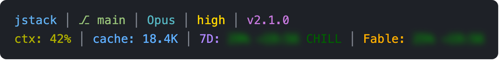

# jstack

한국어 · [English](README.en.md)

Claude Code 플러그인입니다. 계획, 스펙, 프로젝트 문서화(SoT), 리뷰, 커밋을 돕는 스킬 13개와 hook 2개, 사용량 statusline 을 담았습니다.

> 버전 `6.3.0` · 라이선스 MIT

## 설치

```bash
claude plugin marketplace add cjinzy/jstack
claude plugin install jstack@jstack
```

설치 후 Claude Code 를 재시작합니다. 스킬은 `/jstack:<스킬>` 로 부르거나, 설명에 맞는 요청을 하면 Claude 가 알아서 씁니다.

- 업데이트: `claude plugin update jstack@jstack`
- 필요: Claude Code CLI, `git`, `python3`
- 스킬별 추가 요구: `codex-side` 는 [OpenAI Codex CLI](https://github.com/openai/codex), statusline 은 `jq`·`uv`

## 스킬

스킬별 상세 동작은 **[docs/skills.md](docs/skills.md)** 에 있습니다.

| 분류 | 스킬 | 하는 일 |
|---|---|---|
| 시작 | [`claude-init`](docs/skills.md#claude-init) | Claude Code 환경 일괄 구성 (플러그인·설정·statusline). [아래 주의](#작성자-환경이-들어간-부분) |
| | [`onboard`](docs/skills.md#onboard) | 상황별로 어떤 스킬을 쓰는지 안내 |
| 계획 | [`interview`](docs/skills.md#interview) | 구현 전 인터뷰 → 스펙 파일 |
| | [`ambition`](docs/skills.md#ambition) | 계획을 세 축(Altitude·Depth·Range)으로 확장 |
| | [`maestro`](docs/skills.md#maestro) | 세션을 오케스트레이터로 전환, 작업은 하위 세션(agent·herdr pane)에 위임 · 직접 호출만 |
| 문서화 | [`deepinit`](docs/skills.md#deepinit) | 프로젝트 분석 → `AGENTS.md` |
| | [`sot-create`](docs/skills.md#sot-create) | 인용·검증 가능한 프로젝트 문서셋 `sot/` 생성 |
| | [`sot-verify`](docs/skills.md#sot-verify) | `sot/` 가 코드와 맞는지 검증·수정 · 직접 호출만 |
| 리뷰 | [`cleanser`](docs/skills.md#cleanser) | AI 코드 슬롭(디버그 잔재·죽은 코드·과잉 처리) 리포트 |
| | [`codex-side`](docs/skills.md#codex-side) | Codex CLI 로 독립 2차 의견 (review·challenge·consult) |
| 마무리 | [`commit`](docs/skills.md#commit) | gitmoji + 한국어 커밋 메시지로 커밋 |
| | [`mole-linear`](docs/skills.md#mole-linear) | Linear 이슈·댓글 작업 규칙. [아래 주의](#작성자-환경이-들어간-부분) |
| 메타 | [`manage-skills`](docs/skills.md#manage-skills) | 프로젝트용 `verify-*` 검증 스킬 생성·갱신 · 직접 호출만 |

"직접 호출만" 스킬은 `disable-model-invocation` 이 켜져 있어 `/jstack:<스킬>` 로 불러야만 실행됩니다.

## 작성자 환경이 들어간 부분

대부분의 스킬은 어느 프로젝트에서나 그대로 쓸 수 있습니다. 아래 셋은 작성자의 환경을 전제로 합니다.

- **`claude-init`**: 작성자의 Claude Code 환경을 그대로 복제합니다. `~/.claude/CLAUDE.md` 를 작성자 지침으로 덮어쓰고, 설정 기본값(한국어 응답, `opus` 모델, plan 모드 등)과 필수 플러그인을 넣습니다. 바뀌는 파일은 모두 백업하고 롤백 방법을 알려 주지만, 원하는 환경이 아니면 실행하지 마세요. 나머지 스킬은 init 없이 동작합니다.
- **`mole-linear`**: STEALTHMOLE 팀의 Linear 규칙(팀 이름, 상태, 이슈 양식)입니다. 다른 팀은 스킬 파일을 고쳐 써야 합니다.
- **`commit`**: 커밋 메시지를 한국어로 씁니다.

## claude-init 이 하는 일

`/jstack:claude-init` 을 실행하면 단계마다 확인을 받으며 진행합니다. 상세: [docs/skills.md#claude-init](docs/skills.md#claude-init)

1. 현재 설치 상태 점검 → 필요한 단계만 실행
2. 덮어쓰기 동의 + 선택 플러그인 고르기
3. 플러그인 설치 — 필수 3개(`context-mode`, `serena`, `i-have-adhd`) + 고른 선택 플러그인
4. 이 저장소를 `~/.claude/.jin-claude-repo/` 에 clone → statusline, `~/.claude/CLAUDE.md` 와 보조 문서 복사, 사용량 타이머 설치 (macOS launchd / Linux systemd)
5. `~/.claude/settings.json` 병합
6. 설치 환경 충돌 점검 (MCP 중복, 스킬 가림, 충돌 플러그인) → 고른 해결책만 적용
7. 변경 요약·백업 경로·롤백 방법 출력

`settings.json` 에 넣는 키:

| 적용 | 키 |
|---|---|
| 항상 덮어씀 | `env.CLAUDE_CODE_EXPERIMENTAL_AGENT_TEAMS`, `enableAllProjectMcpServers`, `statusLine`, `skipDangerousModePermissionPrompt` |
| 없을 때만 | `permissions.defaultMode: plan`, `outputStyle: Explanatory`, `language: korean`, `effortLevel: high`, `model: opus`, `advisorModel: fable` |

## Hooks

플러그인을 설치하면 항상 동작합니다.

| 이벤트 | 하는 일 |
|---|---|
| `SessionStart` | 이 마켓플레이스 저장소 자동 업데이트(`git pull --ff-only`), init 이 설치한 사용량 타이머가 사라졌으면 재등록, 예전 버전이 `~/.claude/skills` 에 남긴 사본을 백업 폴더로 이동 |
| `UserPromptSubmit` | plan 모드면 ambition 계획 여부를 묻게 하고, 메시지에 `ambition`/`앰비션` 이 있으면 `ambition` 스킬을 로드 |

## Statusline

`claude-init` 이 설치합니다. 세션 정보와 Claude 구독 사용량을 두 줄로 보여 줍니다.



- 1줄: 디렉토리, 브랜치, 모델, effort, Claude Code 버전
- 2줄: 컨텍스트 사용률, 캐시 읽기 토큰, 7일 사용률·리셋까지 남은 시간·속도, 모델별 주간 한도
- 사용률에 따라 녹색 → 빨강 10단계로 색이 바뀝니다.
- 표시 항목은 `~/.claude/statusline-config.txt` 에서 끕니다 (`SHOW_USAGE=0` 등).

사용량은 `fetch-claude-usage` 가 가져옵니다. Claude Code 로그인 토큰(`~/.claude/.credentials.json` 또는 macOS Keychain)으로 `https://api.anthropic.com/api/oauth/usage` 를 호출하고, 결과를 30초 동안 `~/.claude/.usage-cache.json` 에 캐시합니다. Python 표준 라이브러리만 씁니다. 구독(Pro/Max/Team/Enterprise) 계정이 필요합니다.

## 개발

```bash
uv sync                                   # 의존성
uv run ruff check src/ tests/             # 린트
uv run pytest tests/                      # statusline·사용량 테스트
for d in plugins/jstack/skills/*/scripts; do (cd "$d" && uv run pytest -q); done   # 스킬 스크립트 테스트
claude plugin validate .                  # 마켓플레이스·플러그인 검증
```

## 구조

```
.claude-plugin/marketplace.json   마켓플레이스 카탈로그
plugins/jstack/
  .claude-plugin/plugin.json      플러그인 매니페스트
  skills/<스킬>/SKILL.md          스킬 (scripts/·templates/ 포함)
  hooks/                          SessionStart·UserPromptSubmit hook
  scripts/                        statusline, 타이머 설치
src/jin_claude/                   fetch-claude-usage (사용량 CLI)
docs/skills.md                    스킬별 동작 설명
```

## 라이선스

MIT. `codex-side` 의 일부는 [gstack](https://github.com/garrytan/gstack)(MIT, `skills/codex-side/LICENSE-gstack`)에서 가져왔습니다.
